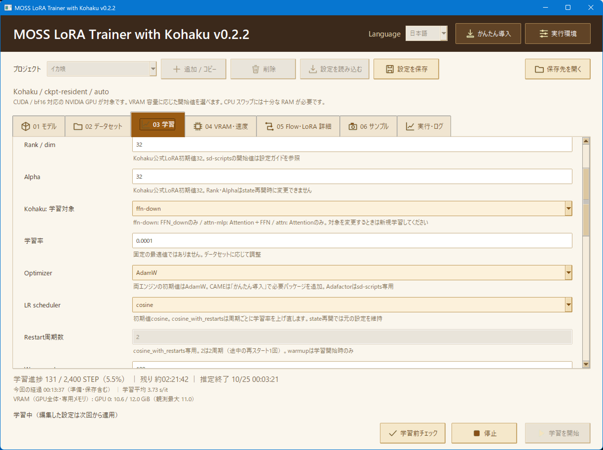

# MOSS LoRA Trainer with Kohaku

**MOSS-ImageのLoRAを作成する、Windows向け学習GUI。**
Kohaku / sd-scriptsの導入から、データセット設定・学習・追加学習・LoRA出力まで操作できます。

[最新版 v0.2.2 をダウンロード](https://github.com/suigin10/MOSS-LoRA-Trainer/releases/latest) · [設定ガイド](docs/STABLE_SETTINGS.md) · [English](docs/QUICK_START.en.md)

## はじめる

**必要なもの：** Windows、Python 3.12（64bit）、CUDA / bf16対応のNVIDIA GPU、モデルと教師画像。
Kohakuには対応するNVIDIAドライバとVisual Studio Build ToolsのC++ワークロードも必要です。
モデルの入手先と12GB向け設定は[設定ガイド](docs/STABLE_SETTINGS.md)を参照してください。

1. [最新版のZIP](https://github.com/suigin10/MOSS-LoRA-Trainer/releases/latest)を展開し、`Start MOSS LoRA Trainer.bat` を起動します。
2. 右上の「かんたん導入」で学習エンジンと専用環境を作成します。
3. 「01 モデル」でモデル、「02 データセット」で教師画像を指定します。
4. 学習設定を確認し、「学習前チェック」→「学習を開始」を押します。

GUIはPython標準のtkinterで動作します。学習用パッケージとTritonは専用環境へ導入します。学習エンジンとモデル本体はZIPに含みません。

## 主な機能

- **2つの学習エンジン：** 新規プロジェクトはKohaku。sd-scriptsも選択できます。
- **プロジェクト管理：** 設定の保存・コピー・読み込みに対応。起動時は最後のプロジェクトを復元し、見つからなければデフォルトで新規作成します。
- **学習と追加学習：** キャッシュ準備、stateからの再開、ログ・進捗・VRAM表示、サンプル生成に対応します。
- **LoRA出力：** KohakuはComfyUI形式・LyCORIS形式で保存。GUIの表示言語は日本語／英語を切り替えられます。

## ガイド

| 知りたいこと | ドキュメント |
| --- | --- |
| モデルの入手先・初期値・12GB向け設定 | [設定ガイド](docs/STABLE_SETTINGS.md) |
| キャプション・プロジェクト・学習・再開・出力先 | [利用ガイド](docs/USER_GUIDE.ja.md) |
| Installation and training in English | [English quick start](docs/QUICK_START.en.md) |
| 不具合報告・開発・実機検証の記録 | [開発・検証](CONTRIBUTING.md) |
| 更新内容 | [変更履歴](CHANGELOG.md) |

## 更新する

アプリを終了してから、新しいZIPのファイルを上書きしてください。**`data/`・`backend/`・モデルは保持してください。** 保存済みの学習設定は維持されます。
旧ランチャー `start.bat`・`install.bat`・`Start MOSS Studio.bat` は削除でき、現在の起動ファイルは `Start MOSS LoRA Trainer.bat` です。

## ライセンス・クレジット

GUIのソースと同梱通知音は[MIT License](LICENSE)です。学習エンジンとモデルには各配布元のライセンスが適用されます。
Kohakuは名称条件付きのKohakuMoss License 1.0で、主要表示名にKohakuを含めています。詳細は[第三者ライセンス](THIRD_PARTY_NOTICES.md)と[ライセンス本文](licenses/)を参照してください。

- [KohakuMossTrainer](https://github.com/KohakuBlueleaf/KohakuMossTrainer)：Kohaku学習バックエンド
- [sd-scripts](https://github.com/kohya-ss/sd-scripts/blob/main/docs/moss_image_train_network.md)：学習バックエンド・設定の参考
- [MOSS-Image](https://github.com/OpenMOSS/MOSS-Image)：対象モデル
- [Anima Standalone Trainer](https://github.com/gazingstars123/Anima-Standalone-Trainer)：GUI・プロジェクト管理の参考

本プロジェクトは独立したGUIであり、上記プロジェクトの公式製品ではありません。
